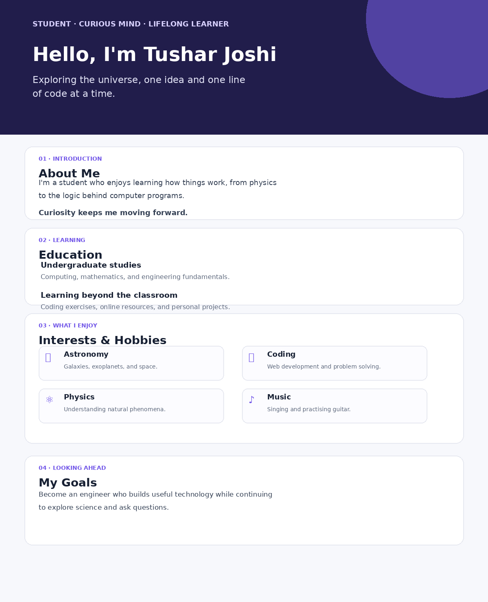

# Day 2: HTML Foundations — Personal Introduction

This project is my personal introduction page, created for the **Web Development Day 02** assignment. It uses HTML to organise information into clear sections and CSS to make the page readable on desktop and mobile screens.

## Preview

## What's on the page?

- **About Me:** A short introduction.
- **Education:** My current learning journey.
- **Interests & Hobbies:** Astronomy, coding, physics, and music.
- **Skills:** Technologies and skills I am building.
- **Goals:** What I hope to learn and achieve.

## How to open the project

No installation is needed.

1. Download or clone this repository.
2. Open the project folder.
3. Double-click `index.html` to open it in a modern web browser.
4. To edit the page, open `index.html` and `style.css` in a code editor such as VS Code.
5. Save your changes and refresh the browser to see them.

## HTML concepts practised

- `<!DOCTYPE html>`, `html`, `head`, `title`, and `body`
- Headings, paragraphs, and text emphasis with `strong` and `em`
- Grouping related content with `div`
- Semantic containers: `header`, `main`, `section`, and `footer`
- Section identifiers using `id` and styling hooks using `class`
- A custom `data-section` attribute
- Linking an external stylesheet

## CSS concepts practised

- Page defaults and reusable CSS custom properties
- Typography, spacing, borders, and backgrounds
- CSS Grid and Flexbox
- A responsive media query for smaller screens

## Git practice

Suggested commits for the assignment:

1. `feat: add basic html structure`
2. `feat: add personal introduction content`
3. `style: add responsive page design`
4. `fix: correct html after devtools practice`
5. `docs: add readme and screenshot`

For the debugging practice, make a temporary copy named `broken.html`, introduce one small HTML error, inspect the page in browser DevTools, and then fix it. Keep `index.html` as the corrected working version.

## Before submitting

- Create your GitHub repository using the required pattern: `rollno-firstname-webdev-day02-personal-intro-page`.
- Replace `rollno` and `firstname` with your own roll number and first name, in lowercase.
- Check that the page displays correctly in a browser.
- Take a fresh screenshot of your own rendered page and keep it at `screenshots/personal-intro.png`.
- Commit your files and push them to GitHub.
- Submit your repository link and screenshot to your instructor.

Do not add private information such as your phone number or home address.
